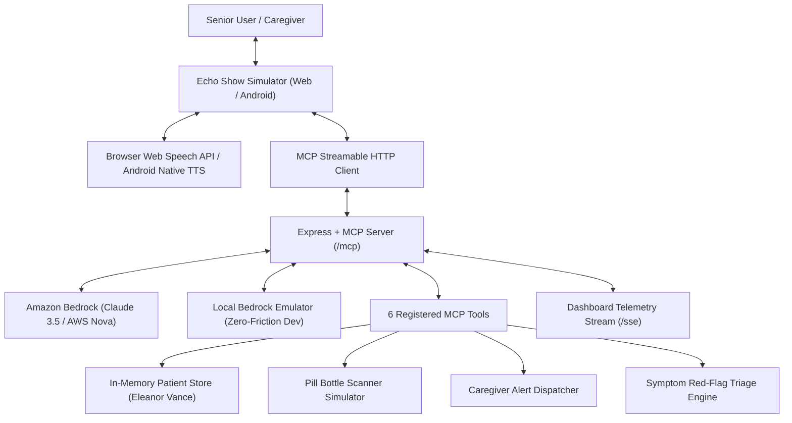

# Vitalis AI — Autonomous AI Eldercare & Health Advocate on Alexa+

[](https://opensource.org/licenses/MIT)
[](https://vitalis-ai-wtdy.onrender.com/)
[](https://vitalis-ai-wtdy.onrender.com/health)
[](https://modelcontextprotocol.io)
[](https://vitalis-ai-wtdy.onrender.com/mcp)
[](https://vitalis-ai-wtdy.onrender.com/health)
[](https://capacitorjs.com/)
[]()

> **Built for the Amazon Developer Hackathon: Build, Ship, Shape (2026)**  
> **Primary Track:** Alexa+  
> **Mini-Challenges:** AWS Builder & Open Source  
> **Live Web Application (Render):** [https://vitalis-ai-wtdy.onrender.com/](https://vitalis-ai-wtdy.onrender.com/)  
> **Source Repository:** [https://github.com/Yemmmyc/vitalis-ai](https://github.com/Yemmmyc/vitalis-ai)  
> **Submission Release:** [Vitalis Care v1.0.1](https://github.com/Yemmmyc/vitalis-ai/releases/tag/v1.0.1)  
> **Product Naming Distinction:** **Vitalis AI** is the overall project/submission name; **Vitalis Care** is the user-facing Android app brand on the mobile device (`com.vitalis.app`).

---

## 🌐 Confirmed Deployment & Public Endpoints

Vitalis AI is deployed as a live cloud Web Service on **Render**, serving both the full-stack interactive Echo Show web simulator and the official Model Context Protocol (MCP) server endpoints.

| Service / Endpoint | Public URL | Description | Verified Status |
| :--- | :--- | :--- | :--- |
| **Public Web Application** | [https://vitalis-ai-wtdy.onrender.com/](https://vitalis-ai-wtdy.onrender.com/) | Interactive Echo Show smart-display web simulator | `Live` |
| **Health Check & Diagnostics** | [https://vitalis-ai-wtdy.onrender.com/health](https://vitalis-ai-wtdy.onrender.com/health) | JSON diagnostics (MCP version, tools count, Bedrock status) | `200 OK` (`healthy`) |
| **MCP Streamable HTTP** | [https://vitalis-ai-wtdy.onrender.com/mcp](https://vitalis-ai-wtdy.onrender.com/mcp) | Official MCP transport endpoint (`POST`/`GET`) | `Spec 2025-11-25` |
| **Dashboard Telemetry SSE** | [https://vitalis-ai-wtdy.onrender.com/sse](https://vitalis-ai-wtdy.onrender.com/sse) | Server-Sent Events stream for real-time dashboard telemetry | `Active` |

### Verified Live Health Diagnostics
A live HTTP GET request to `/health` confirms:
- **`status`**: `"healthy"`
- **`service`**: `"vitalis-alexa-mcp-server"`
- **`mcpSpecVersion`**: `"2025-11-25"`
- **`transport`**: `"Official MCP Streamable HTTP"`
- **`toolsCount`**: `6` registered MCP tools
- **`deployed commit`**: `3a37ca41b0cc41ac5c65ab00ef712c19f8098013` (`3a37ca4`)

> 📖 For comprehensive deployment architecture, Render configuration, and logging details, see the [Render Deployment Guide](file:///c:/Users/yemmm/Desktop/Buld_Ship_Shape/docs/deployment/RENDER_DEPLOYMENT.md).

---

## ⚠️ Important Amazon Bedrock Disclosure

The live deployment health response confirms:
- `bedrock.configured`: `false`
- `bedrock.mode`: `"Local Intelligent Bedrock Emulation (Zero-Friction Dev)"`
- `bedrock.modelId`: `"anthropic.claude-3-5-sonnet-20241022-v2:0"`

> [!IMPORTANT]
> **Distinction Between Emulation and Live AWS Inference**:
> While the health diagnostic returns the target model identifier string `anthropic.claude-3-5-sonnet-20241022-v2:0`, **the deployed cloud service is NOT invoking live Amazon Bedrock API endpoints**.
> 
> Because AWS credentials (`AWS_ACCESS_KEY_ID`, `AWS_SECRET_ACCESS_KEY`) are not provisioned in the deployed Render environment, the application runs in **Local Intelligent Bedrock Emulation** mode. In this mode, the server uses deterministic clinical responses that emulate Claude 3.5 Sonnet's conversational tone without making external AWS network requests.
> 
> Real Bedrock integration is fully implemented in the code using `@aws-sdk/client-bedrock-runtime` and will activate when valid AWS credentials and model access are configured, but live Bedrock invocation remains future work for this deployed instance.

---

## 🌟 Executive Summary & Problem Statement

### Problem Statement
Caring for aging family members presents persistent challenges: maintaining complex medication routines, verifying prescription accuracy, recognizing early signs of health deterioration, and keeping family caregivers informed without compromising the senior's independence. Traditional voice assistants are reactive and lack context-aware tool coordination, while standard health apps can be difficult for seniors to navigate.

### Product Purpose
**Vitalis AI** is an autonomous eldercare assistant and health advocate designed for **Alexa+** smart displays (Echo Show) and mobile devices. Built on the **Model Context Protocol (MCP)** specification `2025-11-25` and powered by **Amazon Bedrock**, Vitalis AI bridges natural voice interaction with structured, safety-first healthcare tools.

It provides a proactive interface for routine medication tracking, visual pill-bottle verification, symptom triage with emergency red-flag detection, daily vital summaries, and caregiver alert dispatching.

---

## 📦 Submission Deliverables & Product Contexts

This repository supports **two distinct submission deliverables**:

| Submission Context | Submission Name | Deliverable Format | Primary Brand / Artifact | Documentation Link |
| :--- | :--- | :--- | :--- | :--- |
| **Original Devpost Hackathon** | **Vitalis AI** | Live Web App Simulator & MCP Server | **Vitalis AI** Echo Show Display ([Live Demo](https://vitalis-ai-wtdy.onrender.com/), `/mcp`) | [`docs/devpost/SUBMISSION_DETAILS.md`](file:///c:/Users/yemmm/Desktop/Buld_Ship_Shape/docs/devpost/SUBMISSION_DETAILS.md) |
| **Qubator QAF 2.0 Submission** | **Vitalis AI** | Native Android APK | **Vitalis Care** (`Vitalis-Care-v1.0.1.apk`, `com.vitalis.app`) | [`docs/qaf-2.0/SUBMISSION_DETAILS.md`](file:///c:/Users/yemmm/Desktop/Buld_Ship_Shape/docs/qaf-2.0/SUBMISSION_DETAILS.md) |

> [!NOTE]
> **Naming & Deliverable Distinction**: **Vitalis AI** is the overall project identity and Devpost submission name. **Vitalis Care** is the user-facing Android launcher brand on the physical mobile device (`com.vitalis.app`). The deployed web smart-display simulator on Render and the native Android APK are complementary deliverables for their respective evaluation environments and must not be confused.

---

## 🎯 Main Features & Intended Users

### Intended Users
- **Seniors & Older Adults**: Seeking an accessible, voice-enabled assistant for daily medication reminders, symptom reporting, and visual pill verification.
- **Family Caregivers & Adult Children**: Wanting peace of mind through real-time caregiver alerts, adherence streaks, and daily vital summaries.
- **Healthcare Coordinators & Developers**: Exploring standardized MCP tool integration between LLMs and healthcare data pipelines.

### Core Capabilities
- 🗣️ **Voice & Smart Display Interface**: Multi-modal Echo Show simulator interface featuring interactive voice interaction with Web Speech API in the browser and native Text-To-Speech on Android.
- 💊 **Medication Routine Management**: Time-of-day filtering (morning, afternoon, evening, bedtime), dose logging (`taken`, `skipped`, `delayed`), and adherence streak calculation.
- 📷 **Pill Bottle Verification Simulation**: Predefined visual verification checking drug identity, dosage, prescription matching, expiration dates, and allergy red flags (e.g., Penicillin allergy warnings).
- 🩺 **Symptom Triage & Red-Flag Detection**: Analyzes symptom reports in natural language, identifies emergency indicators (e.g., chest pain, dyspnea), assigns severity (`EMERGENCY`, `URGENT`, `ROUTINE`), and dispatches caregiver alerts.
- ⚡ **Self-Hosted MCP Streamable HTTP Server**: Full implementation of MCP Spec `2025-11-25` using `@modelcontextprotocol/sdk` and Streamable HTTP transport (`/mcp`).
- 🤖 **Amazon Bedrock Architecture & Emulation**: Integrates Amazon Bedrock SDK (`@aws-sdk/client-bedrock-runtime`) with a high-fidelity local emulation mode when offline or credentials are not supplied.
- 📱 **Native Capacitor 8 Android Companion**: Mobile wrapper built for Android devices, equipped with `@capacitor-community/text-to-speech` for native audio playback, responsive screen-fit layout, and verified microphone permissions (`RECORD_AUDIO`).

---

## 🏛️ Technology Stack & Architecture

### Tech Stack Overview

| Layer | Technologies |
| :--- | :--- |
| **Frontend / Web Simulator** | React 18, Vite 6, TypeScript, Tailwind CSS, Lucide React Icons |
| **Mobile Application** | Capacitor 8 (`@capacitor/core`, `@capacitor/android`), OpenJDK 21, Gradle |
| **Audio & Voice** | `@capacitor-community/text-to-speech` (Native Android TTS), Web Speech API (Browser) |
| **MCP Server / Backend** | Node.js, Express, TypeScript, `@modelcontextprotocol/sdk` (v1.0.4) |
| **MCP Spec & Transport** | Spec `2025-11-25`, Streamable HTTP (`POST/GET /mcp`), SSE Telemetry (`/sse`) |
| **AI / LLM Integration** | `@aws-sdk/client-bedrock-runtime` (Amazon Bedrock) + Local Emulation Fallback |
| **Deployment Platform** | Render Web Service (Node.js runtime, host: `0.0.0.0`) |
| **Testing & Build** | Node Test Runner (`node:test`), TypeScript (`tsc`), Vite Build |

### Architectural Flow



---

## 🛠️ Registered Model Context Protocol (MCP) Tools

Vitalis AI exposes 6 functional MCP tools implementing specification `2025-11-25`:

| Tool Name | Input Arguments | Description & Behavior |
| :--- | :--- | :--- |
| `check_medication_schedule` | `patientId` (string), `timeOfDay` (optional enum: `morning`, `afternoon`, `evening`, `bedtime`, `all`) | Retrieves scheduled medications, calculates current adherence percentage and streak, and filters pending doses by time of day. |
| `log_medication_dose` | `patientId` (string), `medicationId` (string), `status` (enum: `taken`, `skipped`, `delayed`) | Updates medication status. Logging `taken` increments adherence streak; `skipped` or `delayed` updates status without false streak padding. |
| `verify_pill_bottle_vision` | `patientId` (string), `samplePillPreset` (string: `lisinopril_20mg`, `metformin_500mg`, `atorvastatin_40mg`, `penicillin_mismatch`, `expired_aspirin`) | Simulates visual OCR pill-bottle scanning against patient prescription records, checking drug name, dosage, expiration, and patient allergy safety. |
| `evaluate_health_symptoms` | `patientId` (string), `reportedSymptoms` (string) | Evaluates symptom description, flags emergency conditions (e.g., chest pain, difficulty breathing), assigns triage level, dispatches caregiver alerts, and invokes Bedrock. |
| `dispatch_caregiver_alert` | `patientId` (string), `urgency` (enum: `INFO`, `WARNING`, `URGENT`, `EMERGENCY`), `title` (string), `message` (string), `suggestedAction` (optional) | Logs an alert event in the caregiver portal store with urgency metadata and suggested action items. |
| `get_daily_vital_summary` | `patientId` (string) | Returns latest patient physiological metrics (blood pressure, heart rate, blood glucose, hydration, sleep duration) with status indicators. |

---

## 🔒 Verified Working Capabilities vs. Simulated Features

To ensure complete accuracy and transparency, working components are strictly separated from simulated external workflows:

### Verified Working Scope
- ✅ **Deployed Web Service**: Hosted on Render with clean static asset serving and JSON-RPC API handling.
- ✅ **MCP Server & Tool Handlers**: Fully functional MCP server running on Express with Streamable HTTP transport, JSON-RPC protocol compliance, and stateful session management.
- ✅ **6 MCP Tools**: All 6 tools execute verified state transformations in the local `PatientStore`.
- ✅ **Native Android Companion**: Android APK compiled with OpenJDK 21, featuring native Text-To-Speech (`@capacitor-community/text-to-speech`) and verified on physical hardware.
- ✅ **Local Bedrock Emulation**: Instant, deterministic responses when live AWS credentials are not configured.
- ✅ **Dashboard Telemetry**: Active Server-Sent Events stream (`/sse`) broadcasting tool executions and latency metrics.

### Simulated & Non-Production Workflows
- ⚠️ **Camera OCR / Computer Vision**: Pill-bottle verification uses structured test scenarios (`lisinopril_20mg`, `penicillin_mismatch`, `expired_aspirin`) rather than live machine learning image recognition.
- ⚠️ **Caregiver Alert Dispatching**: Caregiver alerts are recorded into the in-memory store (`RECORDED_IN_CAREGIVER_PORTAL`) and displayed on the Caregiver Portal UI; they are not dispatched via live external SMS, telephony, or cellular networks.
- ⚠️ **Browser Voice Interaction**: Voice input and speech synthesis in the web app use browser Web Speech API capabilities; this is a smart-display web simulator and not native Alexa hardware integration.
- ⚠️ **In-Memory State Persistence**: State operates entirely in-memory within `PatientStore` and resets upon server restart or redeployment.

---

## 🧪 Verification & Automated Test Evidence

Vitalis AI has undergone automated and physical verification:

1. **Automated Unit & MCP Test Suite**:
   - **Command**: `npm test`
   - **Result**: `13 / 13 tests passed` (`0 failures`).
   - **Coverage**: Protocol initialization handshake, tool discovery, tool call execution, medication schedule filtering, streak increment logic, skip/delay status handling, pill verification, and emergency red-flag triage.
2. **Production Web & Backend Build**:
   - `npm run build` completes with zero TypeScript errors or bundling warnings.
3. **Android Application & Physical Device Verification**:
   - **User-Facing App Brand**: **Vitalis Care** (`application-label: Vitalis Care`, package: `com.vitalis.app`).
   - **Target Device**: Physical Tecno Spark 20 (`TECNO_KJ7`, Android 13 / API 33).
   - **Permissions Verified**: `android.permission.RECORD_AUDIO` and `android.permission.MODIFY_AUDIO_SETTINGS` confirmed via AAPT badging.
   - **APK Output Asset**: `release-artifacts/Vitalis-Care-v1.0.1.apk` (Size: `4,491,016 bytes`, SHA-256: `663F336628D278B6CE5C14530EAD1182BB6BF8B4CFA105E9D35A822442529248`).

---

## 🚀 Installation & Local Development

### Prerequisites
- **Node.js**: v18.0.0 or higher
- **npm**: v9.0.0 or higher
- **Android SDK / Android Studio** (Optional, only needed for compiling the Android APK)

### 1. Clone Repository & Install Dependencies
```bash
git clone https://github.com/Yemmmyc/vitalis-ai.git
cd vitalis-ai

# Install root server and client dependencies
npm ci
npm ci --prefix client
```

### 2. Configure Environment Variables (Optional)
Copy `.env.example` to `.env`:
```bash
cp .env.example .env
```

Live AWS credentials are **optional**. If omitted, the server operates seamlessly in local emulation mode:
```env
# Server Configuration
PORT=4000
HOST=0.0.0.0

# Optional Amazon Bedrock AWS Credentials (Falls back to local emulator if empty)
AWS_REGION=us-east-1
AWS_ACCESS_KEY_ID=
AWS_SECRET_ACCESS_KEY=
BEDROCK_MODEL_ID=anthropic.claude-3-5-sonnet-20241022-v2:0
```

### 3. Verified NPM Scripts
The following verified commands are defined in `package.json`:

| Command | Script Action | Description |
| :--- | :--- | :--- |
| `npm run dev` | `concurrently "npm run server:dev" "npm run client:dev"` | Starts server (port 4000) and client (port 3000) concurrently |
| `npm run server:dev` | `tsx watch server/src/index.ts` | Runs backend with hot reload on port 4000 |
| `npm run client:dev` | `npm run dev --prefix client` | Runs Vite dev server for frontend on port 3000 |
| `npm test` | `node --test tests/*.test.mjs` | Executes the 13 automated unit tests |
| `npm run build` | `npm run server:build && npm run client:build` | Compiles server TypeScript and builds Vite client |
| `npm start` | `node server/dist/index.js` | Starts compiled production server (serves frontend + MCP) |
| `npm run cap:build` | `npm run client:build && cap sync android` | Builds web client and synchronizes Capacitor Android assets |

### 4. Running the Production Bundle Locally
```bash
# 1. Build server and client
npm run build

# 2. Start production server
npm start
```
- Web Application: `http://localhost:4000/`
- Health Endpoint: `http://localhost:4000/health`
- MCP Endpoint: `http://localhost:4000/mcp`
- Telemetry Stream: `http://localhost:4000/sse`

---

## 🔧 Troubleshooting Guide

### 1. Deployment Startup & Potential Cold Starts
- **Symptom**: Initial request to `https://vitalis-ai-wtdy.onrender.com/` takes 30-50 seconds to respond.
- **Cause**: On cloud hosting platforms such as Render's free tier, inactive services may spin down to conserve resources.
- **Remedy**: Allow the initial health check or web request 30-60 seconds to wake the service. Subsequent requests will respond with sub-second latency.

### 2. Port Binding & Host Configuration
- **Symptom**: Server starts locally but cannot be accessed externally or Render reports port binding failure.
- **Cause**: Binding to `127.0.0.1` or `localhost` prevents external container proxy routing.
- **Remedy**: The server defaults to `HOST=0.0.0.0` and reads `PORT` from `process.env.PORT`. Ensure `HOST` is not overridden to `localhost` in production.

### 3. Local Development Build Issues
- **Symptom**: `npm start` fails with `Cannot find module '.../server/dist/index.js'`.
- **Cause**: Production start requires compiled TypeScript output.
- **Remedy**: Run `npm run build` (or `npm run server:build`) before running `npm start`. For development with auto-compilation, use `npm run dev` instead.

### 4. Bedrock Mode Verification
- **Symptom**: Confusion about whether live AWS Bedrock calls are active.
- **Remedy**: Check the `/health` endpoint. If `bedrock.configured` is `false`, the server is running in local emulation. Provide valid AWS keys in `.env` to enable live Bedrock calls.

---

## 📱 Android APK & AAB Build & Release Automation

To build the user-facing Android app (**Vitalis Care**) locally:

```bash
# 1. Build client web application and synchronize with Capacitor
npm run cap:build

# 2. Compile Debug APK locally (for fast emulator/device testing)
# Windows:
.\android\gradlew.bat -p android assembleDebug
# Linux / macOS:
./android/gradlew -p android assembleDebug
```

### Continuous Build & Release Automation (GitHub Actions)
Automated building, signing, and release publishing is handled through dedicated GitHub Actions workflows:
- **Continuous Build & Verification** ([`.github/workflows/android-build.yml`](file:///c:/Users/yemmm/Desktop/Buld_Ship_Shape/.github/workflows/android-build.yml)): Validates tests, builds web assets, synchronizes Capacitor, and compiles release APK & AAB artifacts on every push to `main`.
- **Version Release Publishing** ([`.github/workflows/android-release.yml`](file:///c:/Users/yemmm/Desktop/Buld_Ship_Shape/.github/workflows/android-release.yml)): Signs release APK and AAB with production keystore secrets and publishes official GitHub Releases when a version tag (`v*`) is pushed.
- **Detailed Setup & Operator Guide**: See [`docs/ANDROID_RELEASE_AUTOMATION.md`](file:///c:/Users/yemmm/Desktop/Buld_Ship_Shape/docs/ANDROID_RELEASE_AUTOMATION.md).

---

## 📁 Repository Documentation Directory Map

```text
vitalis-ai/
├── .github/workflows/             # GitHub Actions CI/CD workflows
│   ├── android-build.yml          # Continuous Android build validation (push to main)
│   └── android-release.yml        # Official signed release publisher (version tags)
├── client/                        # Echo Show Smart Display React/Vite/Tailwind frontend
├── server/                        # Vitalis MCP Server (TypeScript, Express, Spec 2025-11-25)
├── android/                       # Capacitor 8 Android native application project (com.vitalis.app)
├── release-artifacts/             # Published release binaries (Vitalis-Care-v1.0.1.apk)
├── tests/                         # Automated unit & MCP test suite (13 passing tests)
├── docs/                          # Comprehensive documentation catalog
│   ├── README.md                  # Master documentation index & deliverable guide
│   ├── deployment/                # Production Cloud Deployment Documentation
│   │   └── RENDER_DEPLOYMENT.md   # Render live URL, setup, logging, and operational limits
│   ├── ANDROID_RELEASE_AUTOMATION.md # Complete Android CI/CD release & signing guide
│   ├── qaf-2.0/                   # Qubator QAF 2.0 Product Submission documentation
│   │   └── SUBMISSION_DETAILS.md  # QAF 2.0 APK submission specs & physical device evidence
│   ├── devpost/                   # Original Devpost Hackathon project documentation
│   │   ├── SUBMISSION_DETAILS.md  # Devpost hackathon project fields (Alexa+, AWS Builder)
│   │   ├── VIDEO_SCRIPT_3MIN.md   # 3-minute video script & storyboard
│   │   ├── PRODUCT_FEEDBACK.md    # Amazon Developer & Alexa+ tool feedback
│   │   └── FRICTION_LOG.md        # Developer friction log (10% Devpost judging bonus)
│   ├── shared/                    # Shared technical specifications
│   │   └── TECHNICAL_ARCHITECTURE.md # Architecture, 6 MCP tools, Bedrock & fallback
│   └── development/               # Internal developer reference & historical logs
│       └── HACKATHON_MASTER_GUIDE.md # Master guide & test archive
├── capacitor.config.json          # Capacitor configuration (appName: Vitalis Care)
├── package.json                   # Root package configuration & build scripts
├── LICENSE                        # MIT Open Source License
└── README.md                      # Primary open-source repository documentation
```

---

## 🛡️ Security & Privacy Considerations

- **Secret Safety**: No actual AWS access keys, tokens, credentials, or private API keys are committed to Git. `.env` and `local.properties` are listed in `.gitignore`.
- **Data Privacy & PHI**: The application uses dummy demo patient data (`pt-88219`, "Eleanor Vance"). No real Protected Health Information (PHI) or personal patient data is gathered or stored.
- **Local State Scope**: All patient records and logs operate strictly in local memory (`PatientStore`) and reset on server restart, ensuring zero persistent HIPAA liability during testing.

---

## 🔗 Official Repository & Release Links

- **Public Web Application (Render)**: [https://vitalis-ai-wtdy.onrender.com/](https://vitalis-ai-wtdy.onrender.com/)
- **Public Health Endpoint**: [https://vitalis-ai-wtdy.onrender.com/health](https://vitalis-ai-wtdy.onrender.com/health)
- **GitHub Repository**: [https://github.com/Yemmmyc/vitalis-ai](https://github.com/Yemmmyc/vitalis-ai)
- **Latest Release (v1.0.1 - Vitalis Care)**: [https://github.com/Yemmmyc/vitalis-ai/releases/tag/v1.0.1](https://github.com/Yemmmyc/vitalis-ai/releases/tag/v1.0.1)
- **Direct APK Download (v1.0.1)**: [https://github.com/Yemmmyc/vitalis-ai/releases/download/v1.0.1/Vitalis-Care-v1.0.1.apk](https://github.com/Yemmmyc/vitalis-ai/releases/download/v1.0.1/Vitalis-Care-v1.0.1.apk)

---

## 📜 License

Distributed under the **MIT License**. See [`LICENSE`](file:///c:/Users/yemmm/Desktop/Buld_Ship_Shape/LICENSE) for more details.
